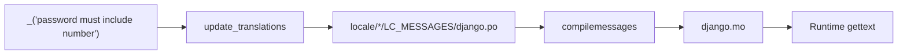

# 🌍 Translations (i18n)

> User-facing strings use Django gettext. Prefer **lowercase**, **space-separated** English msgids (strong recommendation). Locale files live under `locale/` and are refreshed with `python manage.py update_translations` (or `./scripts/update_translations.sh`).

---

## 🎯 Goals

| Goal | How |
|------|-----|
| Translatable API / validation messages | `_()` / `gettext_lazy` on messages |
| Stable, deduplicated msgids | Lowercase English words separated by spaces |
| Parameterized text | `params=` on `ValidationError` — not pre-interpolated msgids |
| Operator workflow | One management command for `makemessages` (+ optional compile) |



---

## ⚙️ Settings

From `config/settings/i18n.py` (generated with `use_i18n=y`):

```python
LANGUAGE_CODE = env("LANGUAGE_CODE", default="en")

LANGUAGES = [("en", "English"), ("fa", "Persian")]

LANGUAGES = [("en", "English")]  # monolingual — add more tuples anytime

USE_I18N = True
LOCALE_PATHS = [os.path.join(BASE_DIR, "locale")]
```

Generation ships starter catalogs under `locale/<code>/LC_MESSAGES/django.po` for each entry in `LANGUAGES` (`en` + `fa``en`). Refresh / extend them with `update_translations` after adding new `_()` strings.

Also wired:

| Piece | Where |
|-------|--------|
| `LocaleMiddleware` | After `SessionMiddleware` in `config/settings/middleware.py` |
| Language switch | `POST /i18n/setlang/` via `django.conf.urls.i18n` |
| Default language | `.env` → `LANGUAGE_CODE` (fallback `en`) |

Clients can send `Accept-Language`; middleware activates the matching catalog.

---

## ✍️ Writing strings in code

### Lazy vs eager

| API | When |
|-----|------|
| `gettext_lazy as _` | Model/serializer/validator attributes evaluated at import time |
| `gettext` / `_` eager | Inside functions when the string is used immediately (e.g. some Django password validator `get_help_text`) |

Password validators in this repo use lazy `_` for `message` attributes and eager gettext in Django adapter `get_help_text()` — see `users/validators/password.py`.

### Lowercase + spaces (strong recommendation)

Prefer every gettext msgid to be:

1. **all lowercase** (no Title Case / sentence capitals in the source string)
2. **words separated by spaces** (human phrase, not `snake_case` or `kebab-case` inside `_()`)

```python
# ✅ preferred
_("password must include number")
_("confirm password is not equal to password")
_("serial number")

# ❌ avoid — Title Case / mixed casing
_("Password must include number")
_("Confirm Password Is Not Equal To Password")

# ❌ avoid — separators that are not spaces
_("password_must_include_number")
_("password-must-include-number")
```

**Why this project prefers it (not a hard product law):**

| Reason | Detail |
|--------|--------|
| One catalog entry | Gettext treats `"Password…"` and `"password…"` as **different** msgids. Teams otherwise translate the same idea twice and drift. |
| Easier to write | Developers don’t debate “capitalize email?” vs “Email”; the rule is boring and scannable. |
| Uniform diffs / reviews | PR reviewers spot new strings without casing noise. |
| Matches labels | Same style as field `verbose_name=_("serial number")` and choice labels. |

Presentation casing (e.g. start a sentence with a capital in the **translated** UI) belongs in the **`.po` translation**, not by inventing a second English msgid.

This is a **strong recommendation**. Ship the consistent form by default. Rare exceptions (proper nouns, legal quotes that must match a trademark) are fine — document why in the PR. When `django-translation-lint` is enabled in pre-commit, **lowercase** is additionally enforced at commit time — see [Code quality](code-quality.md).

### Parameterized messages

```python
# ✅
message = _("password must be at least %(limit_value)d characters")
raise ValidationError(self.message, code=self.code, params={"limit_value": self.limit_value})

# ❌ — freezes the number into the msgid; hard to reuse / translate
_("password must be at least 10 characters")
```

Same pattern for integrity messages using `%(field)s` — see [Validation](../domain/validation.md).

### What to translate

| Translate | Usually don’t |
|-----------|----------------|
| Validation / API user messages | Machine `code` values (`password_mismatch`) |
| Model `verbose_name` / `Meta.verbose_name(_plural)` via `_("serial number")` / `_("card")` | Model `help_text` (required plain English prose on every field — not a msgid) |
| Email subjects/bodies shown to users | Log lines for operators (optional) |
| Rare admin-facing strings you care about | Internal exception class names |

Clients should key off **`messages.*.code`**, not English text — translations will change the `message` field.

---

## 🧰 Updating catalogs

Preferred (management command — source of truth):

```bash
python manage.py update_translations
python manage.py update_translations --locale fa
python manage.py update_translations --compile
```

Thin shell wrapper (`--compile` preferred; `--compile-messages` is a legacy alias):

```bash
./scripts/update_translations.sh
./scripts/update_translations.sh --compile
./scripts/update_translations.sh --compile-messages   # → --compile
make translations
make translations ARGS='--compile'
```

| Step | What happens |
|------|----------------|
| Locales | Defaults to **every** code in `settings.LANGUAGES` (works for 0–N languages — no script edits when you add one); override with `--locale` |
| Update | `makemessages` ignoring `venv`, `node_modules`, `staticfiles`, `media`, … |
| Cleanup | Uses gettext tools (`msgattrib`, `msgcat`) when installed — `brew install gettext` on macOS |
| Compile | With `--compile`, runs `compilemessages` for `.mo` files |

Commit `.po` files with string changes. Prefer committing compiled `.mo` only if your deploy pipeline does not run `compilemessages` (many teams compile in Docker build).

---

## 🧪 Checking conventions


Pre-commit includes **django-translation-lint** (when enabled in generation) to keep `_()` msgids lowercase — optional tooling that backs the strong recommendation above. Run:

```bash
pre-commit run --all-files
```

When adding code-style tooling, enable a gettext lowercase check so msgid casing does not drift (still a convention preference in the docs; the hook is what makes it mechanical).


Also spot-check new validators/services for missing `_()` on user-facing strings.

---

## ➕ Adding a new language

Scripts and the management command **never** hardcode a language count — they always follow `settings.LANGUAGES` (or explicit `--locale` flags). To add a third (or Nth) language:

1. Append `("xx", "Name")` to `LANGUAGES` in `config/settings/i18n.py` (keep `LANGUAGE_CODE` as the default).
2. Create the tree if needed: `locale/xx/LC_MESSAGES/` (optional — `makemessages` creates it).
3. `python manage.py update_translations --locale xx`  
   Or run without `--locale` to refresh **all** languages in `LANGUAGES`.
4. Translate strings in `locale/xx/LC_MESSAGES/django.po`.
5. `python manage.py update_translations --compile` (or deploy-time `compilemessages`).
6. Tell API clients to send `Accept-Language: xx` (or use `POST /i18n/setlang/`).

No changes to `scripts/update_translations.sh`, the Makefile target, or the management command are required when growing from 1 → 2 → N locales.

---

## ❌ Anti-patterns

| Anti-pattern | Fix |
|--------------|-----|
| Title Case / mixed-case msgids | Prefer lowercase source English |
| Snake_case / kebab-case inside `_()` | Prefer space-separated words (`_("serial number")`) |
| Duplicate msgids that differ only by casing | Reuse one lowercase msgid; capitalize in the locale translation if needed |
| f-strings inside `_()` | `_("hello %(name)s") % {"name": …}` or `params=` / `format` after gettext |
| Translating error **codes** | Keep codes stable English snake_case |
| Editing `.mo` by hand | Edit `.po`, then compile |
| Scattering raw English in APIs without `_()` | Wrap user-visible strings |
| A second i18n library beside Django gettext | Stay on Django |

---

## ✅ Checklist: new user-facing string

1. Wrap with `_()` / `gettext_lazy`
2. Prefer lowercase, space-separated msgid (strong recommendation)
3. Use `params=` for dynamic values
4. Run `python manage.py update_translations`
5. Ensure API also sets a machine `code=` where applicable

---

## 🔗 Related docs

| Doc | Why |
|-----|-----|
| [Validation](../domain/validation.md) | Where most API messages live |
| [Code quality](code-quality.md) | Translation lint hook |
| [Settings](settings.md) | `i18n.py` |
| [Commands](commands.md) | Script / make entrypoints |
